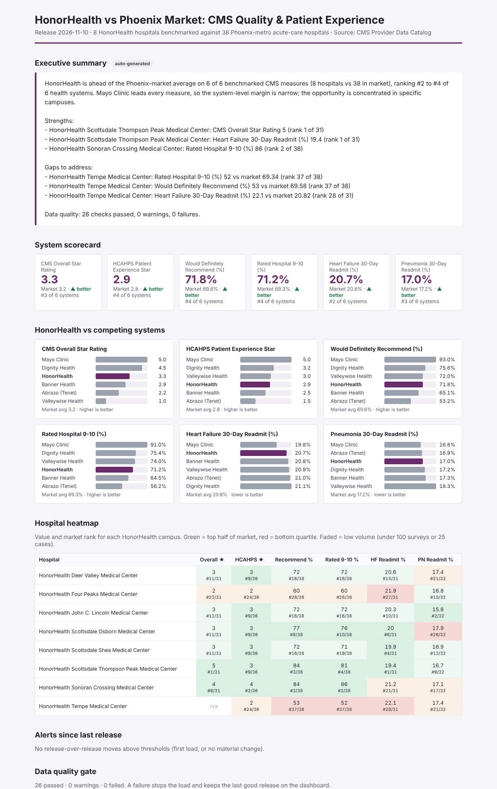
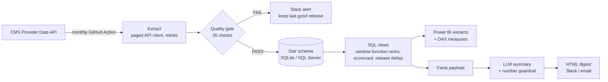

# HonorHealth CMS Quality & Patient Experience Benchmark

**Live dashboard: https://manudhannayak.github.io/hospital-quality-benchmark/**


An automated BI pipeline that pulls public CMS hospital data each month, runs it through a data quality gate,
models it in a star schema, benchmarks HonorHealth's 8 hospitals against the Phoenix market, and delivers
a Power BI-ready model, an HTML digest, and an AI-written summary that is checked against the source numbers.

**Data source:** [CMS Provider Data Catalog](https://data.cms.gov/provider-data/), the official public data behind
Medicare Care Compare. It's free, needs no API key, and is refreshed by CMS about quarterly.

| Dataset | CMS ID | Measures used |
|---|---|---|
| Hospital General Information | `xubh-q36u` | Overall hospital star rating |
| Patient Survey (HCAHPS) - Hospital | `dgck-syfz` | HCAHPS summary star, % would definitely recommend, % rating hospital 9-10 |
| Unplanned Hospital Visits - Hospital | `632h-zaca` | 30-day readmission rate, heart failure and pneumonia |



## What it found (CMS data, HCAHPS Oct 2024 - Sep 2025, readmissions Jul 2023 - Jun 2025)

- HonorHealth beats the Phoenix-market average on all 6 measures, but ranks **#2 to #4 of 6 health systems**.
  Mayo Clinic leads every measure, and Dignity Health is ahead on patient experience.
- **Thompson Peak** is the market's top hospital for overall star rating (5 stars, #1 of 31) and heart failure
  readmissions (19.4%, #1 of 31). **Sonoran Crossing** ranks #2 of 38 on "rated hospital 9-10" (86%).
- **Tempe** is the outlier: 53% would definitely recommend and 52% rate it 9-10, both **#37 of 38** in the market.
  Its heart failure readmission rate rests on only 25 cases, so treat that one with caution.
- **Four Peaks** sits in the bottom third on patient experience (60%, #28 of 38) and heart failure readmissions (#27 of 31).

## Architecture



| Step | File | What it does |
|---|---|---|
| Extract | `src/hqb/cms_client.py`, `ingest.py` | Paged pulls from the CMS datastore API, then normalizes three datasets into one long format |
| Validate | `validate.py` | Volume, key uniqueness, referential integrity, expected measures, suppression rate, value ranges, reporting period. A FAIL blocks publishing. |
| Load | `transform.py`, `sql/schema.sql` | `dim_hospital`, `dim_measure`, `dim_release`, `fact_measure`. History is kept per release; re-runs are idempotent. |
| Model | `sql/views.sql` | `RANK() OVER` market ranks that respect measure direction, system scorecard, `LAG()` release-over-release change |
| Analyze | `analyze.py` | Builds a facts payload: gaps vs market, system rank, top and bottom quartile campuses, threshold alerts |
| Narrate | `narrative.py` | Claude writes the executive summary from the facts only. Any number not in the facts is rejected and replaced by a template. |
| Publish | `site.py`, `docs/index.html` | Writes `docs/data.json`; GitHub Pages serves the interactive dashboard from `docs/` |
| Deliver | `deliver.py` | Self-contained HTML report, Slack webhook, SMTP email, and a failure alert |
| BI layer | `powerbi/` | DAX measures (gap vs market, direction-aware rank, rank heatmap color, prior-release change) and a page-by-page build guide |
| Schedule | `.github/workflows/refresh.yml` | Monthly cron: tests, live CMS pull, artifacts, commits warehouse history |

## Run it

```bash
pip install -r requirements.txt
export PYTHONPATH=src

python -m hqb.pipeline --source snapshot   # bundled real CMS snapshot, works offline
python -m http.server -d docs 8000          # view the dashboard at localhost:8000
python -m hqb.pipeline --source cms        # live pull from data.cms.gov
pytest -q                                  # 12 tests
```

Outputs go to `output/`: `benchmark_report.html`, `powerbi/*.csv`, `warehouse.db`, `facts.json`, `dq_results.json`.

Optional environment variables:
- `ANTHROPIC_API_KEY` turns on the AI summary.
- `SLACK_WEBHOOK_URL` turns on the Slack digest and failure alerts.
- `SMTP_HOST`, `SMTP_USER`, `SMTP_PASSWORD` and `REPORT_EMAIL_TO` turn on email.

To benchmark a different system or market, edit `config/settings.yaml` and `config/health_systems.csv`. No code changes are needed.

## Design decisions

- **Measure direction is data, not code.** `higher_is_better` lives in `dim_measure`, so readmissions rank lowest-first
  in SQL, in DAX and in the summary, without any special cases.
- **Suppression is expected.** CMS hides results for small hospitals. The gate tracks the suppression rate per measure
  and fails only on spikes. Low-volume results (under 100 surveys or 25 cases) are flagged and excluded from the strengths and gaps lists.
- **The LLM is optional and checked.** The pipeline never depends on the model. When it is used, every number in its
  output has to trace back to the facts payload.
- **System averages are unweighted means of the system's hospitals**, which matches how leadership compares campuses.
  A volume-weighted version is an easy extension.
- **SQLite for portability.** The schema and views are ANSI SQL plus window functions, so they port to SQL Server and Epic Clarity
  reporting environments with minor changes.

## Limitations

- Public CMS data lags 6 to 18 months and only covers Medicare-reporting measures. Internally, the same pipeline pattern
  would sit on Epic Clarity / Caboodle and Press Ganey feeds for current data.
- 11 critical-access and children's hospitals had truncated attributes in the snapshot. They're outside the Phoenix acute-care peer group, so the benchmark isn't affected.
- Not affiliated with HonorHealth or CMS.
